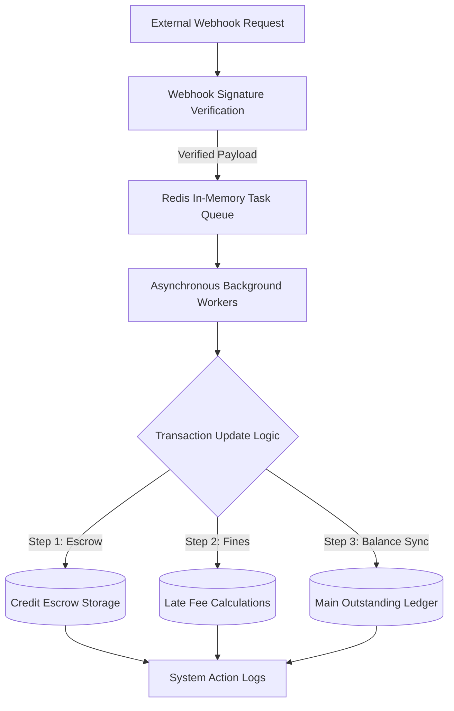

# ⚡ Asynchronous Billing Queue and Balance Ledger Engine

This repository contains the architecture and core processing code for an event-driven transaction ledger. The project functions as a practical testbed to evaluate **Race Condition Mitigation**, **Stateful Balance Processing**, and **Payload Validation** within asynchronous, high-concurrency background queues.

The primary development goal is to maintain absolute financial ledger consistency and prevent data corruption when handling rapid, simultaneous balance updates under heavy queue loads.

---

### 📐 Queue Management & Balance Ledger Architecture



---

## 🔬 Core Systems Engineering Focus

Processing account balances asynchronously requires targeted software structures to completely eliminate data collision hazards, floating-point rounding errors, and database table serialization deadlocks.

### 1. Asynchronous Task Control & Race Condition Mitigation
The framework utilizes isolated background workers designed to process sequential database updates without causing conflicting data changes:
* **Background Task Buffering:** Uses in-memory data streams (**Redis Queue Workers**) to store incoming webhook requests, safely preventing transaction drops or database thread exhaustion during major traffic spikes.
* **Row-Level Database Locking:** Implements strict database write sequencing to ensure balance math operations evaluate accurately, even if multiple updates for the same client account arrive at the exact same millisecond.

### 2. Payload Security & Exact Math Precision
To ensure incoming balances originating from external integrations are authentic and error-free, the ingest gateway enforces strict validation rules:
* **Signed Payload Verification:** Incoming webhook events are validated using secure digital signatures to confirm authenticity before hitting the core storage engine.
* **Exact Decimal Accuracy:** Bypasses floating-point variable limits by enforcing exact precision database schemas, preventing tiny fraction rounding errors from multiplying across thousands of sequential transactions.

---

## 📊 System Complexity & Processing Limits

The transaction processing engine was analyzed under continuous traffic streams to document runtime behavior constraints.

### 1. Process Complexity Metrics
* **Execution Footprint:** Core context verification, database lookups, and queue dispatches run predictably, resolving at a steady O(1) time complexity cost.
* **System Stability:** Built to ingest and process transaction streams continuously without dropping data packets, leaking states, or hitting table locking deadlocks.

### 2. Planned Development Extensions
* Integrate standard distributed verification models (such as exploring a **Two-Phase Commit** or lightweight replication setup) to coordinate balances safely across separated cluster nodes.
* Evaluate **Write-Ahead Logging (WAL)** strategies to guarantee local storage history survival during abrupt background server crashes.

---

## 🛠️ Repository Directory Layout

The codebase maps to clean functional directories, separating task queue rules, balance calculations, and incoming validation gates:
*   📁 **`src/Core/`** — Main transaction calculations, billing balance updates, and account history records.
*   📁 **`src/Queue/`** — Redis background jobs configuration, worker triggers, and exception handling.
*   📁 **`src/Security/`** — Webhook signature checks and secure digital payload validation rules.

---

## ⚙️ Development Stack Primitives

* **Language Engine:** PHP 8.x (Optimized background processing setups)
* **Task Broker:** Redis (Asynchronous background task processing queue)
* **Relational Storage:** MySQL (Optimized exact precision decimal fields)
* **Validation Gateway:** Secure Cryptographically Signed Webhooks

---

## 🚀 Setting Up the Local Testing Sandbox

### Step 1: Clone the Repository
```bash
git clone https://github.com/Karan-kb/High-Precision-Utility-Billing-Engine.git
cd High-Precision-Utility-Billing-Engine
```

### Step 2: Configure Environment Settings
Set up a standard operating configuration file (`.env`) inside the root folder to map your local database paths and Redis server credentials.

### Step 3: Start the Queue Workers
Run your base application dependencies, execute the table schema migrations, and activate the background ledger task processors:
```bash
composer install
php artisan queue:work --queue=ledger_transactions
```

---

## 👨‍💻 Maintainer

* **Karan B.C.** - Backend Software Engineer | [GitHub Profile](https://github.com/Karan-kb) | [LinkedIn Profile](https://www.linkedin.com/in/karan-b-c-2162a81b8/)
